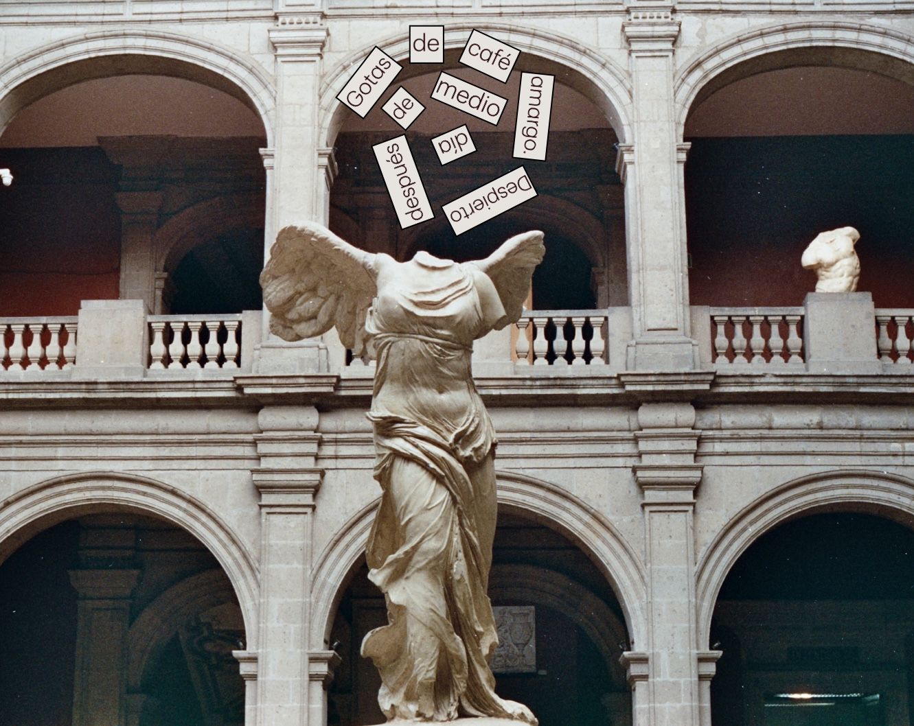

# Algorithmic_Poetry

[**Visita la página publicada**](https://miroslava-mosso.github.io/Algorithmic_Poetry/)

Experimental poetry + mathematics.

Is it possible to write poetry from mathematical rules?

This question is part of a tradition of literary experimentation at **Oulipo** — *Ouvroir de littérature potentielle, translated as "workshop of potential literature"* — a movement that was born in France in 1960.

My introduction to this tradition comes from the potential poetry laboratories in Mexico, organized by [**Regina Roze**](https://www.instagram.com/batsssht/), through [**popoesía**](https://www.instagram.com/popoesia/), where I have had the opportunity to learn and to experiment with different forms of poetic creation.

From these experiences, **Algorithmic Poetry** was born, which is a digital notebook where I gather my own explorations within visual and mathematical poetry.

The poems on the webpage are my own compositions, using techniques developed by various people that I mention there. With them, I experiment with different mathematical constraints, probing how rules can transform the relation between words, space, mathematical structures, and algorithms to create **P O E T R Y**.

Because sometimes, a constraint is not the limit of creativity, but the place where new possibilities begin.

In addition, I developed an algorithmic proposal, inspired by the **Hodge diamond**, where this algebraic geometry structure becomes a template and recipe to build poems. I also open space for other people to experiment with this algorithm and share their own compositions.

My contribution is to continue with this ***dialogue between mathematics and literature***. This work has been possible thanks to the collective tradition, and through the people who have kept it alive, and those who have brought me closer to it.

